<h1 align="center">🚀 42 School Badges</h1>

<p align="center">
  <b>Collectible achievement badges for the new 42 School Common Core</b><br>
  <sub>After the curriculum moved to Python, the Common Core got a brand new set of projects — and now they have their own achievements.</sub>
</p>

<p align="center">
  <a href="https://github.com/SaraFreitas-dev/42-School-Badges/stargazers"></a>
  <a href="https://github.com/SaraFreitas-dev/42-School-Badges/issues"></a>
</p>

---

## ✨ How to use

1. Find your project in the tables below.
2. Open **📋 Copy Milestone N badges** under the table, then use GitHub's copy icon on the code block of the badge you want.
3. Paste it into your own `README.md`.

**Badge tiers**

| Frame | Meaning |
|:---:|:---|
| 🟣 Purple | Project completed |
| 🟡 Gold ★ | Project completed **with bonus** |
| 🔵 Cyan | Exam passed |

> 💡 Badges are animated SVGs. Prefer a static image? Every badge also exists as a **PNG** in the `png/` folder of each milestone inside [`Badges/`](Badges).

---

## 🌌 Milestone 0

<table>
<tr><th width="200">Project</th><th width="300">Badge</th><th width="300">With bonus</th></tr>
<tr>
<td align="center" width="200"><b>libft</b></td>
<td align="center" width="300"><a href="https://github.com/SaraFreitas-dev/42_School_Badges"></a></td>
<td align="center" width="300"><b>N/A</b></td>
</tr>
</table>

<details><summary><h3>📋 Copy Milestone 0 badges</h3></summary>

**libft**

```html
<a href="https://github.com/SaraFreitas-dev/42_School_Badges"></a>
```

</details>

## 🌌 Milestone 1

<table>
<tr><th width="200">Project</th><th width="300">Badge</th><th width="300">With bonus</th></tr>
<tr>
<td align="center" width="200"><b>get_next_line</b></td>
<td align="center" width="300"><a href="https://github.com/SaraFreitas-dev/42_School_Badges"></a></td>
<td align="center" width="300"><a href="https://github.com/SaraFreitas-dev/42_School_Badges"></a></td>
</tr>
<tr>
<td align="center" width="200"><b>push_swap</b></td>
<td align="center" width="300"><a href="https://github.com/SaraFreitas-dev/42_School_Badges"></a></td>
<td align="center" width="300"><a href="https://github.com/SaraFreitas-dev/42_School_Badges"></a></td>
</tr>
<tr>
<td align="center" width="200"><b>ft_printf</b></td>
<td align="center" width="300"><a href="https://github.com/SaraFreitas-dev/42_School_Badges"></a></td>
<td align="center" width="300"><a href="https://github.com/SaraFreitas-dev/42_School_Badges"></a></td>
</tr>
</table>

<details><summary><h3>📋 Copy Milestone 1 badges</h3></summary>

**get_next_line**

```html
<a href="https://github.com/SaraFreitas-dev/42_School_Badges"></a>
```

**get_next_line ★ bonus**

```html
<a href="https://github.com/SaraFreitas-dev/42_School_Badges"></a>
```

**push_swap**

```html
<a href="https://github.com/SaraFreitas-dev/42_School_Badges"></a>
```

**push_swap ★ bonus**

```html
<a href="https://github.com/SaraFreitas-dev/42_School_Badges"></a>
```

**ft_printf**

```html
<a href="https://github.com/SaraFreitas-dev/42_School_Badges"></a>
```

**ft_printf ★ bonus**

```html
<a href="https://github.com/SaraFreitas-dev/42_School_Badges"></a>
```

</details>

## 🌌 Milestone 2

<table>
<tr><th width="200">Project</th><th width="300">Badge</th><th width="300">With bonus</th></tr>
<tr>
<td align="center" width="200"><b>Born2beroot</b></td>
<td align="center" width="300"><a href="https://github.com/SaraFreitas-dev/42_School_Badges"></a></td>
<td align="center" width="300"><a href="https://github.com/SaraFreitas-dev/42_School_Badges"></a></td>
</tr>
<tr>
<td align="center" width="200"><b>A-Maze-ing</b></td>
<td align="center" width="300"><a href="https://github.com/SaraFreitas-dev/42_School_Badges"></a></td>
<td align="center" width="300"><a href="https://github.com/SaraFreitas-dev/42_School_Badges"></a></td>
</tr>
<tr>
<td align="center" width="200"><b>Python Modules 00–10</b></td>
<td align="center" width="300"><a href="https://github.com/SaraFreitas-dev/42_School_Badges"></a></td>
<td align="center" width="300"><b>N/A</b></td>
</tr>
<tr>
<td align="center" width="200"><b>Exam Rank 02</b></td>
<td align="center" width="300"><a href="https://github.com/SaraFreitas-dev/42_School_Badges"></a></td>
<td align="center" width="300"><b>N/A</b></td>
</tr>
</table>

<details><summary><h3>📋 Copy Milestone 2 badges</h3></summary>

**born2beroot**

```html
<a href="https://github.com/SaraFreitas-dev/42_School_Badges"></a>
```

**born2beroot ★ bonus**

```html
<a href="https://github.com/SaraFreitas-dev/42_School_Badges"></a>
```

**a-maze-ing**

```html
<a href="https://github.com/SaraFreitas-dev/42_School_Badges"></a>
```

**a-maze-ing ★ bonus**

```html
<a href="https://github.com/SaraFreitas-dev/42_School_Badges"></a>
```

**python_modules**

```html
<a href="https://github.com/SaraFreitas-dev/42_School_Badges"></a>
```

**exam_rank_02**

```html
<a href="https://github.com/SaraFreitas-dev/42_School_Badges"></a>
```

</details>

## 🌌 Milestone 3

<table>
<tr><th width="200">Project</th><th width="300">Badge</th><th width="300">With bonus</th></tr>
<tr>
<td align="center" width="200"><b>Call Me Maybe</b></td>
<td align="center" width="300"><a href="https://github.com/SaraFreitas-dev/42_School_Badges"></a></td>
<td align="center" width="300"><a href="https://github.com/SaraFreitas-dev/42_School_Badges"></a></td>
</tr>
<tr>
<td align="center" width="200"><b>Fly-In</b></td>
<td align="center" width="300"><a href="https://github.com/SaraFreitas-dev/42_School_Badges"></a></td>
<td align="center" width="300"><a href="https://github.com/SaraFreitas-dev/42_School_Badges"></a></td>
</tr>
<tr>
<td align="center" width="200"><b>Codexion</b></td>
<td align="center" width="300"><a href="https://github.com/SaraFreitas-dev/42_School_Badges"></a></td>
<td align="center" width="300"><b>N/A</b></td>
</tr>
<tr>
<td align="center" width="200"><b>Exam Rank 03</b></td>
<td align="center" width="300"><a href="https://github.com/SaraFreitas-dev/42_School_Badges"></a></td>
<td align="center" width="300"><b>N/A</b></td>
</tr>
</table>

<details><summary><h3>📋 Copy Milestone 3 badges</h3></summary>

**call_me_maybe**

```html
<a href="https://github.com/SaraFreitas-dev/42_School_Badges"></a>
```

**call_me_maybe ★ bonus**

```html
<a href="https://github.com/SaraFreitas-dev/42_School_Badges"></a>
```

**fly-in**

```html
<a href="https://github.com/SaraFreitas-dev/42_School_Badges"></a>
```

**fly-in ★ bonus**

```html
<a href="https://github.com/SaraFreitas-dev/42_School_Badges"></a>
```

**codexion**

```html
<a href="https://github.com/SaraFreitas-dev/42_School_Badges"></a>
```

**exam_rank_03**

```html
<a href="https://github.com/SaraFreitas-dev/42_School_Badges"></a>
```

</details>

## 🌌 Milestone 4

<table>
<tr><th width="200">Project</th><th width="300">Badge</th><th width="300">With bonus</th></tr>
<tr>
<td align="center" width="200"><b>NetPractice</b></td>
<td align="center" width="300"><a href="https://github.com/SaraFreitas-dev/42_School_Badges"></a></td>
<td align="center" width="300"><b>N/A</b></td>
</tr>
<tr>
<td align="center" width="200"><b>RAG against the machine</b></td>
<td align="center" width="300"><a href="https://github.com/SaraFreitas-dev/42_School_Badges"></a></td>
<td align="center" width="300"><a href="https://github.com/SaraFreitas-dev/42_School_Badges"></a></td>
</tr>
<tr>
<td align="center" width="200"><b>Pacman</b></td>
<td align="center" width="300"><a href="https://github.com/SaraFreitas-dev/42_School_Badges"></a></td>
<td align="center" width="300"><b>N/A</b></td>
</tr>
<tr>
<td align="center" width="200"><b>Exam Rank 04</b></td>
<td align="center" width="300"><a href="https://github.com/SaraFreitas-dev/42_School_Badges"></a></td>
<td align="center" width="300"><b>N/A</b></td>
</tr>
</table>

<details><summary><h3>📋 Copy Milestone 4 badges</h3></summary>

**netpractice**

```html
<a href="https://github.com/SaraFreitas-dev/42_School_Badges"></a>
```

**rag_against_the_machine**

```html
<a href="https://github.com/SaraFreitas-dev/42_School_Badges"></a>
```

**rag_against_the_machine ★ bonus**

```html
<a href="https://github.com/SaraFreitas-dev/42_School_Badges"></a>
```

**pacman**

```html
<a href="https://github.com/SaraFreitas-dev/42_School_Badges"></a>
```

**exam_rank_04**

```html
<a href="https://github.com/SaraFreitas-dev/42_School_Badges"></a>
```

</details>

## 🌌 Milestone 5

<table>
<tr><th width="200">Project</th><th width="300">Badge</th><th width="300">With bonus</th></tr>
<tr>
<td align="center" width="200"><b>Inception</b></td>
<td align="center" width="300"><a href="https://github.com/SaraFreitas-dev/42_School_Badges"></a></td>
<td align="center" width="300"><a href="https://github.com/SaraFreitas-dev/42_School_Badges"></a></td>
</tr>
<tr>
<td align="center" width="200"><b>The Answer Protocol</b></td>
<td align="center" width="300"><a href="https://github.com/SaraFreitas-dev/42_School_Badges"></a></td>
<td align="center" width="300"><b>N/A</b></td>
</tr>
<tr>
<td align="center" width="200"><b>treenity</b></td>
<td align="center" width="300"><a href="https://github.com/SaraFreitas-dev/42_School_Badges"></a></td>
<td align="center" width="300"><b>N/A</b></td>
</tr>
<tr>
<td align="center" width="200"><b>Agent Smith</b></td>
<td align="center" width="300"><a href="https://github.com/SaraFreitas-dev/42_School_Badges"></a></td>
<td align="center" width="300"><b>N/A</b></td>
</tr>
<tr>
<td align="center" width="200"><b>Exam Rank 05</b></td>
<td align="center" width="300"><a href="https://github.com/SaraFreitas-dev/42_School_Badges"></a></td>
<td align="center" width="300"><b>N/A</b></td>
</tr>
</table>

<details><summary><h3>📋 Copy Milestone 5 badges</h3></summary>

**inception**

```html
<a href="https://github.com/SaraFreitas-dev/42_School_Badges"></a>
```

**inception ★ bonus**

```html
<a href="https://github.com/SaraFreitas-dev/42_School_Badges"></a>
```

**the_answer_protocol**

```html
<a href="https://github.com/SaraFreitas-dev/42_School_Badges"></a>
```

**treenity**

```html
<a href="https://github.com/SaraFreitas-dev/42_School_Badges"></a>
```

**agent_smith**

```html
<a href="https://github.com/SaraFreitas-dev/42_School_Badges"></a>
```

**exam_rank_05**

```html
<a href="https://github.com/SaraFreitas-dev/42_School_Badges"></a>
```

</details>

## 🌌 Milestone 6

<table>
<tr><th width="200">Project</th><th width="300">Badge</th><th width="300">With bonus</th></tr>
<tr>
<td align="center" width="200"><b>ft_resume</b></td>
<td align="center" width="300"><a href="https://github.com/SaraFreitas-dev/42_School_Badges"></a></td>
<td align="center" width="300"><b>N/A</b></td>
</tr>
<tr>
<td align="center" width="200"><b>ft_transcendence</b></td>
<td align="center" width="300"><a href="https://github.com/SaraFreitas-dev/42_School_Badges"></a></td>
<td align="center" width="300"><a href="https://github.com/SaraFreitas-dev/42_School_Badges"></a></td>
</tr>
<tr>
<td align="center" width="200"><b>Exam Rank 06</b></td>
<td align="center" width="300"><a href="https://github.com/SaraFreitas-dev/42_School_Badges"></a></td>
<td align="center" width="300"><b>N/A</b></td>
</tr>
</table>

<details><summary><h3>📋 Copy Milestone 6 badges</h3></summary>

**ft_resume**

```html
<a href="https://github.com/SaraFreitas-dev/42_School_Badges"></a>
```

**ft_transcendence**

```html
<a href="https://github.com/SaraFreitas-dev/42_School_Badges"></a>
```

**ft_transcendence ★ bonus**

```html
<a href="https://github.com/SaraFreitas-dev/42_School_Badges"></a>
```

**exam_rank_06**

```html
<a href="https://github.com/SaraFreitas-dev/42_School_Badges"></a>
```

</details>

---

## 📁 Structure

```
Badges/
├── Milestone_0/
│   ├── svg/   ← animated
│   └── png/   ← static
├── Milestone_1/
│   ...
└── Milestone_6/
```

---

## 💬 Feedback

Any suggestion is very welcome! If you have an idea, spot a mistake, or a project is missing, please [open an issue](https://github.com/SaraFreitas-dev/42_School_Badges/issues).

## ⭐ Support

If you like these badges, **give the repo a star** and **share it** with your fellow 42 students!

<p align="center"><sub>Made with 💜 by <a href="https://github.com/SaraFreitas-dev">SaraFreitas-dev</a> · 42 Porto</sub></p>